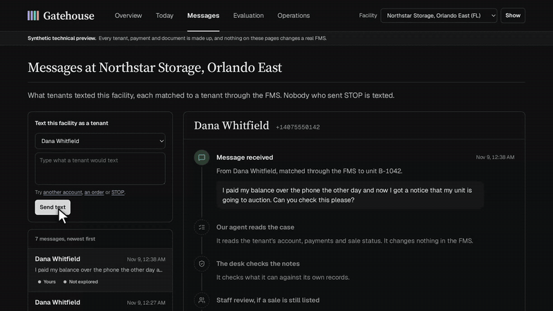

# Gatehouse

Unfinished work in self-storage, checked against the FMS.

[](https://gatehouse-peug.onrender.com)

**[Open the live preview](https://gatehouse-peug.onrender.com)**: the full three-minute walkthrough plays with sound at the top of the Overview, and every screen runs on a live simulator.

## What it does

Operators already run an FMS, a payment processor, a gate system and reminder tools. The costly failures sit between them. Gatehouse finds that work, keeps the evidence, and closes an item only when the system of record shows the fact that proves it done.

- **Payments.** A card payment whose answer was lost is held, never charged twice. A payment the bank sends back reopens the account.
- **Access.** A tenant who paid and is still locked out goes to the top of Today. A task marked done is not proof.
- **Lien files and sales.** A file goes back to a person when the account changes. A paid unit still listed for auction gets one FMS task.
- **Messages.** Every text is matched to a tenant. Our agent reads the case, and the desk writes the reply from verified records. STOP always wins.
- **Reminder check and rent changes.** Who a reminder must not reach, and whether a rent increase was billed at the new rent.
- **Evaluation.** Every build runs the failures and stops on a red line.

## Screens

| | |
|---|---|
|  |  |
|  |  |

## Run it

```bash
cp .env.example .env          # set DESK_OPERATOR_TOKEN to a long random string
docker compose up --build     # Gatehouse on :8000, the FMS simulator on its loopback
```

The tests and the evaluation run in Docker, from the `test` target of the Dockerfile.

## More

The [full write-up](docs/details.md) covers where it fits, each part in depth, how it is built, the API, the Florida lien rules and the limits.

All tenants, facilities and payments are synthetic. The FMS simulator follows Cubby's public API documentation; it is not an official integration. Lien-law reference data is from the [Stitch Storage dataset](https://stitchstorage.com/self-storage-lien-laws/data), CC BY 4.0. Gatehouse does not give legal advice, process real payments or authorize property sales.
