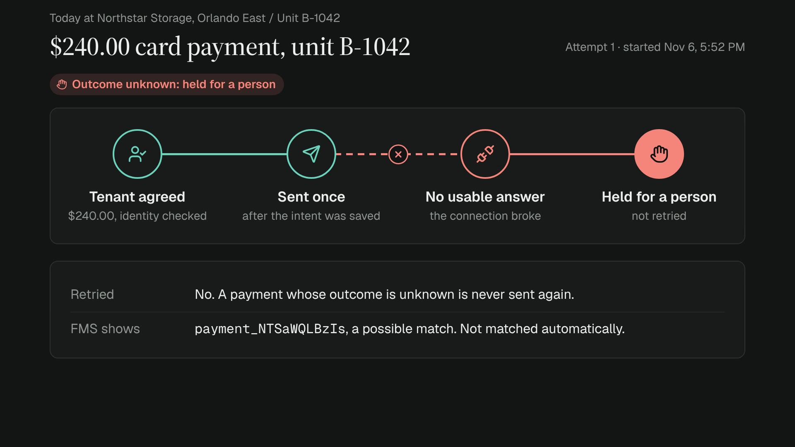
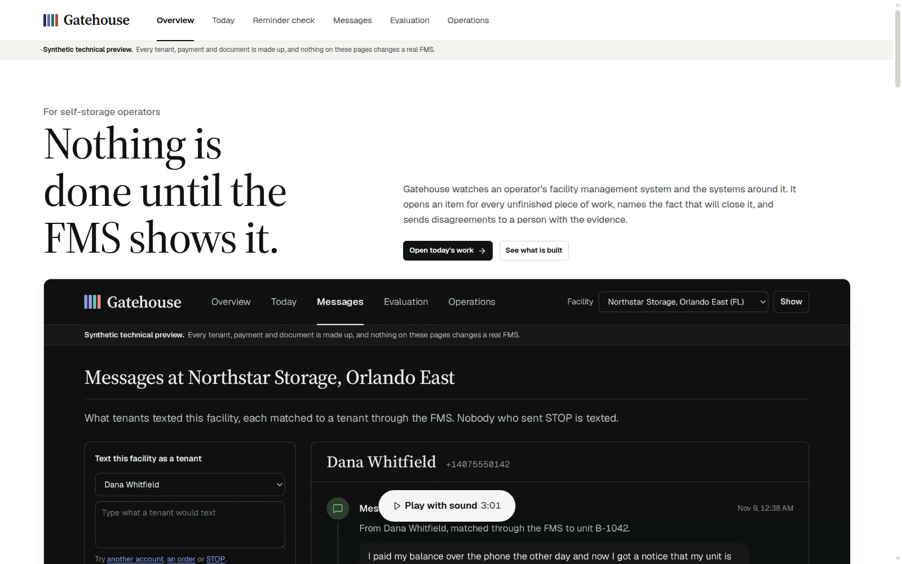
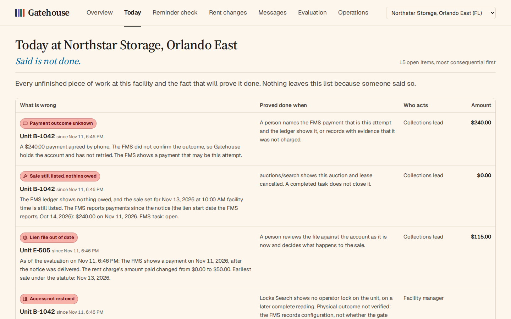
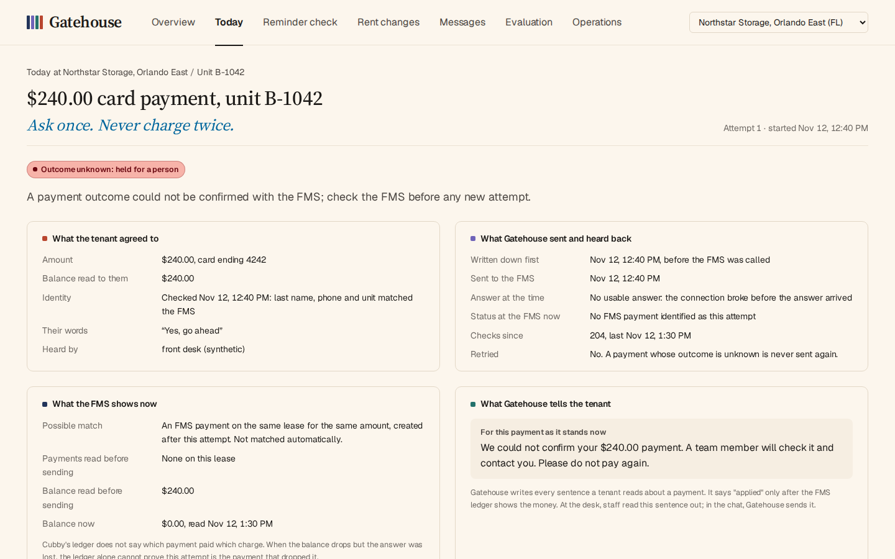
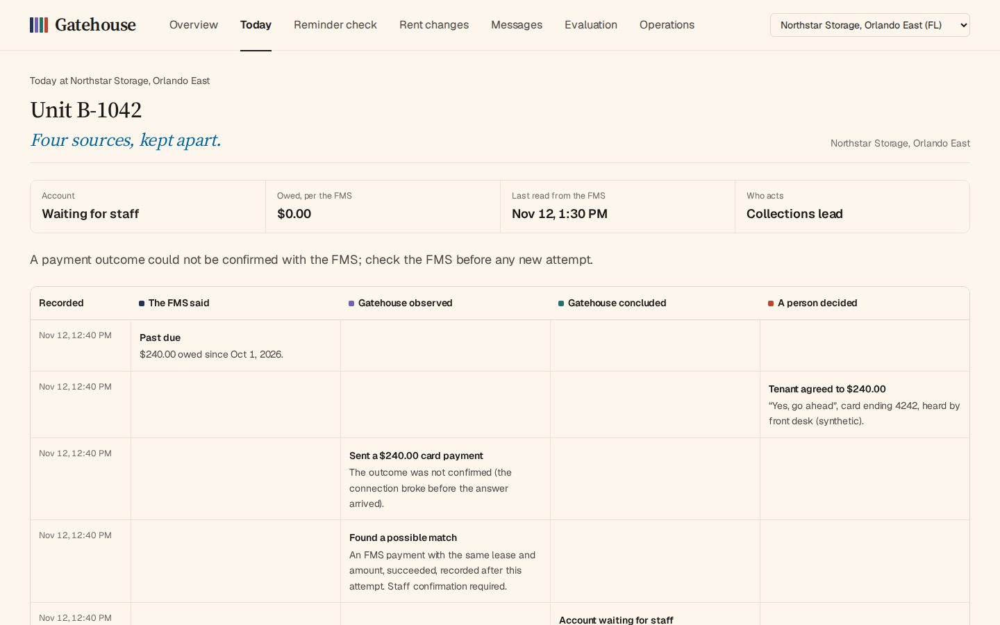
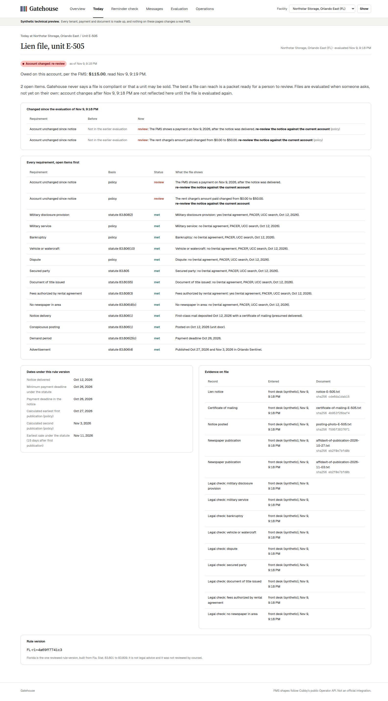
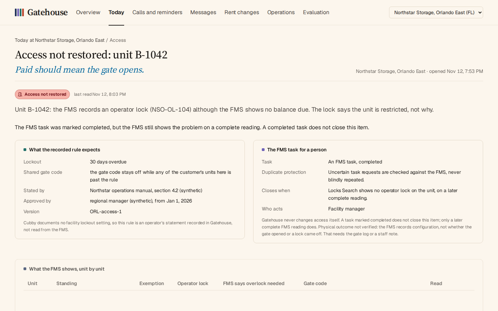

# Gatehouse

Operations reconciliation for self-storage, checked against the FMS.

Self-storage operators already run a facility management system (FMS), a payment processor, a gate system, a call service and often a lien vendor. The expensive failures happen between them: work one system reports done that another never finished. A card is charged and the FMS never shows it. A returned payment leaves the account closed. A lien file stays built on a balance that has changed. A paid tenant is still locked out.

Gatehouse finds that work, keeps the evidence, and closes an item only when the system of record shows the fact that proves it done. When the systems disagree, a person decides from the evidence. When one fact changes, Gatehouse checks again every piece of work it touches.

[](desk/static/film/gatehouse-film.mp4)

A 29-second loop of one lost payment, built from the app's own screens (click the frame for the video). Its source is in `film/`.

## Screens

| | |
|---|---|
|  **Overview.** What Gatehouse is, with the film and each built part. |  **Today.** Every open item at a facility, worst first, with what proves it done. |
|  **A held payment.** What the tenant agreed to, what was sent and heard back, and what the FMS shows now. |  **The record.** Four lanes: what the FMS said, what Gatehouse observed and concluded, and what a person decided. |
|  **A lien file.** Every requirement with its basis and evidence, and what changed since the last evaluation. |  **An access item.** The recorded rule, the FMS task, and what the FMS shows unit by unit. |

## What is built and what is next

| Part | Status | Done means |
|---|---|---|
| Collections and payments | Built | The FMS shows the payment succeeded and the ledger shows the money on the charges the tenant agreed to pay |
| Florida lien evidence | Built | Every requirement has a record; the best a file reaches is a packet for a person to review |
| Access and overlocks | Built | The FMS's gate code and unit locks match the facility's recorded lockout rule, in both directions, on a complete reading |
| Lien sales | Built | A sale still listed after the account was paid is cancelled in the FMS (auctions/search shows it), and an outside listing is withdrawn by that site's own report |
| Messages | Built | A tenant's text is matched to a tenant through the FMS, never by a number someone typed, and every STOP is honoured. "Explore with our agent" reads that tenant's records and writes case notes; a staff review of a listed sale is linked or asked for, and read back from the FMS |
| Leads and move-ins | Planned | A missed call counts as recovered only when a specific lease is linked to it |
| Rent changes | Planned | An approved increase is saved, noticed and charged in the FMS, with what happened after |

The hosted preview is read-only and runs on synthetic data. Its home page shows each built part with a live excerpt, and Today lists the open work at a facility. Each item opens to the record behind it, kept in four lanes: what the FMS said, what Gatehouse observed, what Gatehouse concluded, and what a person decided. The lost payment also shows the simulator's own record of what happened, which a real FMS cannot show.

## Collections and payments, and lien evidence

- **Past-due queue.** One worklist per facility: what is owed, what was last attempted, what is blocking the account and who has to act.
- **Payments the tenant actually agreed to.** After a fresh identity check, the desk builds a proposal from the FMS balance and the tenant's saved cards, and a payment can only be taken by confirming one, with the name of the person who heard the tenant's yes and the tenant's words; anything but a clear yes is refused. Confirming it twice returns the same payment.
- **One charge, confirmed by the ledger.** One open payment per unit, enforced by the database, and no new charge while any payment on the lease is still pending at the FMS, whoever took it. The intent is written before the FMS is called. A payment counts as applied only when money lands on the charges that were open when the tenant agreed and no other payment on the lease could have put it there. Cubby's ledger does not say which payment paid which charge, so when another payment is in motion the desk does not guess: a person decides.
- **Every outcome has a state.** Declines (an HTTP 200 at Cubby), pending gateway answers, lost responses, FMS failures, late application, refunds, disputes and returns each land in a defined state. A pending payment is never retried. A lost response gets a suggested FMS payment, never an automatic match. What the desk cannot establish goes to staff, who need their own token and record what they found (naming a payment says which one an attempt was; confirming it posted takes their statement that they checked the ledger); "not charged" is refused while the FMS shows the payment pending or succeeded, or while a possible match is unaccounted for. The unit stays held until then.
- **Tenant conversation.** A tenant can check and pay a past-due balance by message. A language model handles the conversation but has no tool that charges a card: it can propose an amount, and the card is charged only when the tenant's very next message is a plain yes to that proposal. The model never writes anything the tenant reads: it chooses an action (verify, read the balance, propose a payment, check its status, explain a charge, ask to clarify, hand off) and the desk sends its own sentence, built from the FMS ledger and the payment record. Text the model writes anyway is logged and not sent. Identity comes from what the caller types, lasts 15 minutes and is never renewed by the model; a conversation answers only the sender who started it. Three wrong identity answers, hardship, military service, liens and anything legal go to a person.
- **Lien evidence, not legal answers.** For a Florida account, operators record the notice, how it was delivered, the posting, each newspaper publication and the legal checks (military disclosure and service, bankruptcy, vehicle or watercraft, dispute, secured party), each with its document. The desk evaluates the file against rule version FL-r1 and lists every open item with its basis: a section of Fla. Stat. 83.801-83.809, or an operator policy the desk applies on top of the statute. The best a file can reach is "Review packet assembled": every listed requirement has a record, with its document or transcription kept where one is needed. Nothing here authenticates those documents: a person still has to check them, and sale authorization is outside this desk. New York is reference only and every New York case goes to counsel; other states have no reviewed rule version.

## Access and overlocks

- **The rule is stated, not guessed.** Cubby documents no facility lockout setting, so the rule (days overdue before lockout, and what one shared gate code does when only some of a customer's units are past it) is recorded in Gatehouse with who approved it and from when. A facility without one gets a review item, not a verdict.
- **Both directions are work.** Each pass reads every customer's gate code and its check, the locks on each unit, the lease's overlockNeeded and any exemption from the FMS. A tenant who is current or exempt but still has an operator lock or a disabled code, and an account past the rule whose code the FMS still allows or whose unit has no lock, each open an item. A lock in operator use says the unit is restricted, not why, so the task asks a person to check before taking it off.
- **A task is a request, not proof.** Gatehouse asks for a person through one FMS task per item, recording the intent and a marker before the call. If the answer is lost, it looks the task up by its marker and never creates another while the outcome is unknown. A task marked completed does not close the item; only a later complete FMS reading showing the expected state does. A failed read changes nothing.
- **Configuration is not the physical world.** The FMS records codes and locks. Whether the gate opened or the lock came off needs the gate log or a staff note, and every access item says so.

## Lien sales

- **The sale is read again with the account.** Each pass reads the facility's sales from auctions/search and, for every listed or settled unit, the ledger and payments in the same pass. A stored reading never decides a sale, and a failed read decides nothing and says the item was not freshly verified.
- **Nothing owed, still listed.** That opens the most urgent item on Today and one FMS task asking staff to cancel the sale or say why it stands. A zero balance with no payment since the notice is not called a tenant payment; a credit or waiver may explain it.
- **A payment is not a legal conclusion.** A payment after the notice that leaves a balance, and a sale already settled on an account with nothing owed or payments since the notice, go to a person and counsel. The FMS does not say whether a sale came before or after a payment, so Gatehouse claims no order, and a bidder's payment is never read as the tenant's.
- **Closing needs its own evidence.** "FMS lien cancellation verified" means auctions/search shows that auction and lease cancelled, and nothing more; a completed task closes nothing. If a payment comes back before the cancellation, the item moves to review and its task is marked as resting on the older reading. A listing on an outside auction site is its own item, closed only by that site's feed. Gatehouse never cancels, settles or completes a sale.

## Messages

The Messages page lists what tenants texted a facility, newest first. For the message you choose it shows the conversation beside what our agent did about it. "Explore with our agent" reads that tenant's account, payments and sale status, may ask for a staff review of a sale that is still listed, and writes the case notes. It changes nothing in the FMS. While it runs, the page shows each step as it happens, taken from the run itself.

The case notes are written by a language model from the records the desk holds. The desk checks what it can and shows the records beside the notes: the sale the notes rely on must be open and read lately, and every amount and date in the notes must appear in a record. A run costs about a fifth of a cent. The preview allows ten explorations per visitor per day and one dollar a day in all.

## How it is built

- A FastAPI service with a database and a reconciliation worker.
- An FMS simulator behind a real HTTP boundary, modeled on Cubby's published Operator API: integer cents, envelopes, key roles and PII scope, payment statuses where a decline is still a 200 and a pending payment must never be retried. It can decline, refuse, fail, return pending, apply the money late, lose a response after charging, sit behind a failing gateway, or reverse a payment later, so the failure paths are exercised, not assumed.
- An adapter layer between the desk and the FMS. Vendor details stay in the adapter; the desk works on a small, vendor-neutral model.
- A scenario runner that plays each failure against the running system and reports what the desk did and what the tenant was told.

## Running it

```bash
cp .env.example .env            # set DESK_OPERATOR_TOKEN to a long random string
docker compose up --build       # one container: Gatehouse and its worker on :8000, the FMS simulator on its loopback
```

`start.sh` is what the container runs: the simulator listens on 127.0.0.1:8100 inside it and is never published, Gatehouse listens on `$PORT` (8000 by default), and if either process stops the container stops. `/health/live` says the process answers; `/health/ready` checks the database, the FMS and the worker.

The hosted preview sets `DESK_DEMO_SEED=1` and `DESK_PUBLIC_VIEW=1`: on an empty database Gatehouse builds a synthetic world by running its own flows against the simulator (a payment whose answer was lost, a returned payment, a Florida lien file reopened by a payment, a New York file sent to counsel), and anyone may read it without a token. Every change still needs the operator token, and the public view refuses to start against anything but the local simulator.

With `DESK_PUBLIC_INVESTIGATE=1` and a model key, any visitor of the preview can press "Explore with our agent" on a message at `/inbox` and watch the case notes get written live. The limits are `DESK_DAILY_BUDGET_USD` (one dollar a day in all, counting the most each run still going could cost) and `DESK_VISITOR_CASES_PER_DAY` (ten per visitor, a visitor being a hash of where the request came from, never the address). Both count in New York time. A refused request is told why in plain words. The counts live in the desk's database, so a restart of the preview starts them again; a public link needs a guard that a restart cannot reset.

There are no migrations yet: after pulling schema changes, start from fresh volumes (`docker compose down -v`). That includes moving from the earlier three-service compose file, whose `desk-data` and `fms-data` volumes the single container does not use.

Every desk route expects `X-Desk-Token: <DESK_OPERATOR_TOKEN>`; resolving a payment held for staff also needs `X-Staff-Token: <DESK_STAFF_TOKEN>`. Taking a payment at the front desk:

```bash
H="X-Desk-Token: $TOKEN"; J="Content-Type: application/json"
curl -X POST -H "$H" localhost:8000/api/facilities/fac_NSorlando01/sync
curl -H "$H" localhost:8000/api/facilities/fac_NSorlando01/queue
curl -X POST -H "$H" -H "$J" localhost:8000/api/cases/1/identity \
  -d '{"last_name": "Whitfield", "phone_last4": "0142", "unit_name": "B-1042"}'
curl -X POST -H "$H" -H "$J" localhost:8000/api/cases/1/proposals \
  -d '{"identity_check_id": "<from the identity check>", "amount": 24000}'
curl -X POST -H "$H" -H "$J" localhost:8000/api/cases/1/proposals/<proposal_id>/confirm \
  -d '{"confirmed_by": "J. Ortiz", "tenant_answer": "Yes, go ahead"}'
```

Texts reach the desk as Cubby's SMS Received webhook (`POST /webhooks/cubby/sms-received`, with `X-Webhook-Token: <DESK_WEBHOOK_TOKEN>`). Each one is kept once, matched to a tenant by the FMS's own record, and listed at `GET /api/facilities/{id}/inbox`. Cubby documents no signing, so the desk trusts whoever holds the token. If a gateway such as Make.com adds it, that gateway's own incoming URL must not be open to the public. A number that several facilities share needs `DESK_TEXT_NUMBERS`, a JSON map from the receiving number to a facility id; without it the text is kept at `GET /api/inbox/unrouted`. A text for a facility the desk has not read yet is kept there too, and filed once the facility is read. A text is kept only if it belongs to this operator: its facility is one the FMS key sees, or, for a shared number, its organization is. Anything else is refused with a 404. `POST /api/inbox/{id}/reply` answers one through Cubby's text call, and refuses with the reason when the number texted STOP, the FMS has texts switched off, or Cubby would send the text to a different number than the one that asked.

`POST /api/inbox/{id}/investigate` (operator token and a request id) has a language model read a matched text, look up the desk's own records through read-only tools bound to that tenant and that facility, and submit a case packet. The packet is a summary and a reason in the model's own words, plus the list of records it relied on, which staff read word for word. The desk keeps its own check apart from it. Everywhere a run is shown, in the run and in the inbox, the response has the same parts: `notes` (the model's words, labeled "Case notes"), `records`, `verified` and `actions`. It checks that every record the packet lists came from a lookup in the run, and that the dollar amounts and calendar dates it can read in the summary and the reason are in one of those records or in the tenant's message (it reads the common written forms; anything spelled out in words is not read). For a sale claim it also reads its own sale item and says what that item shows, including whether the FMS reported a payment. The model may also ask for a staff review of an open sale item it was shown. It is only asked: once the packet is accepted and checked, the desk links the FMS task that asks a person to act on that sale, or asks the FMS for it when its own check confirmed the sale, and reads the task back from the FMS before anything is shown as done (the outcome is linked, requested, not confirmed, refused or not requested; the model is never told which). A text has one run unless `again` is set, and a double click is one run. Each run records its tokens and cost, and `GET /api/agent-runs/{id}` shows it with its lookups. It needs `ANTHROPIC_API_KEY`.

The conversation endpoint needs `ANTHROPIC_API_KEY` in `.env` (Claude Haiku 5.5, the only model the desk prices; `DESK_CHAT_MODEL` refuses any other at startup). Each model call's tokens and estimated cost are logged; a whole conversation costs about a tenth of a cent.

```bash
curl -X POST -H "$H" -H "$J" localhost:8000/api/cases/1/chat \
  -d '{"sender": "+14075550142", "text": "Hi, how much do I owe on my unit?"}'
```

To watch the desk handle each FMS failure, run the scenarios against the simulator (they reset it first):

```bash
docker compose exec gatehouse python -m desk.scenarios --fms http://127.0.0.1:8100
```

```
PASS  Response lost after charging      FMS: charges and applies, answers too late
                                        desk: NEEDS_STAFF with the FMS payment suggested; staff confirmed it: CONFIRMED; 1 charge
                                        tenant hears: Your payment of $240.00 has been applied to your account.
PASS  FMS fails mid-request             FMS: HTTP 500, nothing recorded
                                        desk: NEEDS_STAFF, new attempts blocked until staff cleared it
                                        tenant hears: We checked your $240.00 payment with our records: it was not charged.
PASS  Counter payment at the same time  FMS: ours applies late; a cash payment lands first
                                        desk: AWAITING_APPLICATION (the ledger cannot say whose money is whose), NEEDS_STAFF, staff checked the ledger: CONFIRMED
                                        tenant hears: Your payment of $240.00 has been applied to your account.
...
12 of 12 scenarios behaved as they should.
```

Tests run against the simulator over real HTTP: `pip install -e ".[dev,chat]" && pytest`. One test calls the real model and is skipped unless `DESK_LIVE_MODEL=1` is set.

## Lien files (Florida, rule version FL-r1)

```bash
curl -X POST -H "$H" -H "$J" localhost:8000/api/cases/1/lien/evidence -d '{"kind": "mail_deposit", "entered_by": "J. Ortiz",
  "document_name": "certificate-of-mailing.pdf.txt", "document_text": "PS Form 3817 ...",
  "facts": {"notice_id": 12, "deposited_on": "2026-10-02", "certificate_of_mailing": true, "postage_prepaid": true,
            "address": "88 Pine St, Orlando FL", "address_basis": "rental agreement"}}'
curl -H "$H" localhost:8000/api/cases/1/lien
```

How dates work: every date is a calendar date at the facility, in the time zone the FMS reports for it (no default). A stated payment deadline stays open through its whole local day, and the next step can start the day after. With delivery on November 6, the earliest deadline is November 20, the first publication can run November 21, the second on November 28, and the sale threshold under this policy is December 6.

What the statute says and what is policy:

| Check | Basis |
|---|---|
| Delivery in person, by e-mail, or by first-class mail (recorded as such) with a certificate of mailing; mail is presumed delivered on deposit | 83.806(1), (3) |
| Unconfirmed e-mail needs the first-class fallback before any sale | 83.806(1) |
| Notice content: itemized claim, property description, demand of at least 14 days after delivery, sale statement, owner contact | 83.806(2) |
| Posting at the facility or on the unit, recorded with where and whether it was conspicuous | 83.806(1) |
| Advertisement once a week for two consecutive weeks after the demand period, with its required content; sale at least 15 days after the first publication | 83.806(4) |
| Rental agreement discloses uniformed-services membership; any charge that is not rent authorized by the agreement; a late fee above the statute's safe harbor ($20 or 20 percent of the monthly rent, whichever is greater) checked for reasonableness; vehicles and watercraft; secured parties; no document of title issued (which would put the arrangement under chapter 677) | 83.808(2), 83.808(3), 83.806(10), 83.805, 83.803(5) |
| Each itemized charge is an open charge on the FMS ledger and was due when the notice was delivered, the stated due date is the earliest charge's, the sale time exists on the facility's clock, the owner's phone is complete; e-mail went to the tenant's last known address; the earliest sale is 15 days after the first publication | 83.806(1), 83.806(2), 83.806(4)(b)3 |
| The newspaper is one of general circulation in the facility's area, with how that was established | 83.806(4) |
| The itemized claim adds up and equals the FMS ledger snapshot the notice was built from, taken before delivery | 83.806(2)(a), compared as policy |
| Posting dated the day of delivery; publications exactly seven days apart; an e-mail confirmed only by a later reply is dated by the reply; unconfirmed e-mail counts from the fallback mailing; every legal check recorded as yes, no or unknown, and anything but a clean no goes to counsel; any payment after delivery, or any change to the claimed charges since the snapshot (a waiver, a return, a new amount), reopens review; a payment on the delivery day counts as after it | policy |
| Every record keeps its document (the notice, the certificate, the confirmation, the acknowledgment, the posting photo, the publisher's affidavit); delivery, posting and publication count only for the notice record they name, so a corrected notice is served again (new evidence for an old, corrected notice is refused) | policy |

Each evaluation keeps the exact facts it read, including each document's hash and the rule version with a fingerprint of the code that evaluated it, and can be replayed only by that same code to the same result (`GET /api/lien/evaluations/{id}/replay`). Evidence is append-only in the database itself (no update, delete or replacing insert); a correction supersedes the record it fixes, once.

Not covered: checking what a kept document actually says (a person does that), sending notices, scheduling or conducting sales, commercial reasonableness, lien priority, proceeds and surplus notices, the no-newspaper posting route (such files go to counsel), vehicle towing, and any reading of Cubby's delinquency exemptions as legal clearance. The append-only rule is enforced by triggers on SQLite; another database needs the same rule in its migrations. Like the payment confirmations, "entered by" is an attested name under one shared desk token.

## Limits

- One deployment serves one operator: its own database, FMS key and operator token. The database records which FMS account it belongs to and the desk refuses to start against another.
- Conversations live in the API process; a restart ends them (proposals and payments are in the database). Identity checks are serialized per case within one process. Running several API processes needs both moved into the database.
- Card processing fees are not modeled. Where an FMS deducts a fee from the charged amount, the ledger shows less than the charge and the payment goes to staff instead of confirming.
- Ledger evidence: an outside payment that succeeded more than a day before a desk payment is taken to be on the ledger already. Cubby exposes no payment-to-charge allocation, so a shorter rule would send every payment to staff and a longer one cannot be proven either; it is a stated policy (`RECENT_OUTSIDE_PAYMENT`).
- Settled payments and paid cases are re-read for 180 days (card disputes run to about 120 days, ACH returns to 60); a later return is caught the next time the lease is read.

## Data, rules and limits of use

- All tenants, facilities and payments are synthetic.
- The FMS simulator follows Cubby's public API documentation. It is a simulation, not an official integration, and implies no endorsement.
- State lien-law reference data comes from the Stitch Storage self-storage lien law dataset (https://stitchstorage.com/self-storage-lien-laws/data), licensed CC BY 4.0. It is stored as published and used as reference material only.
- Gatehouse does not determine legal compliance, process real payments, send statutory notices or authorize property sales. Jurisdiction-specific rules require independent legal review before any operational use.
