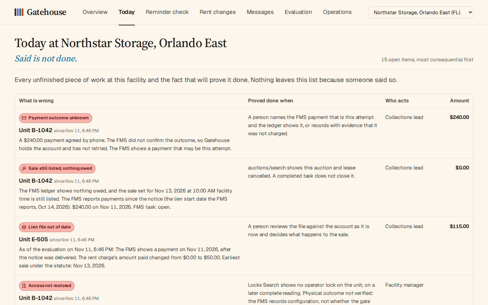
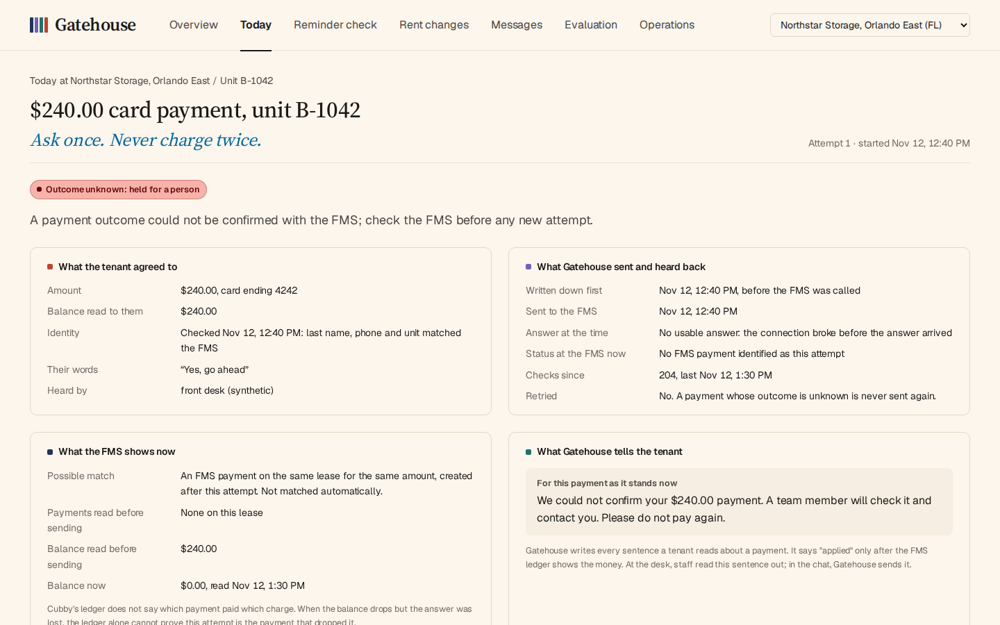
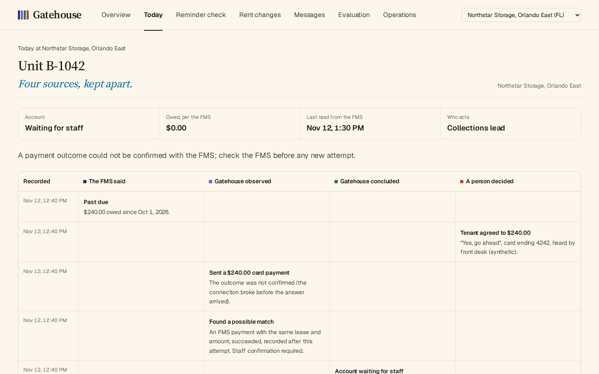
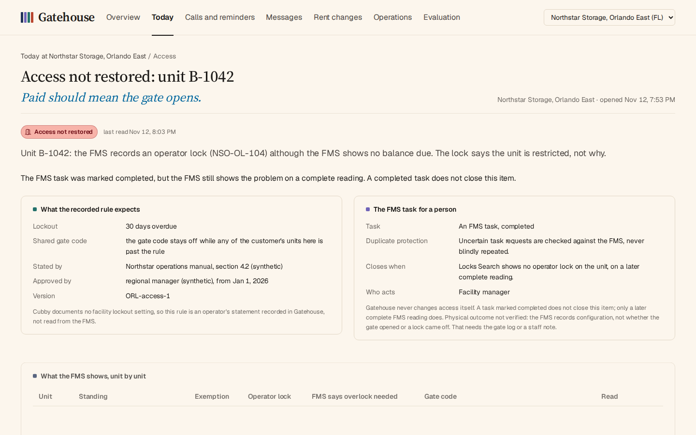
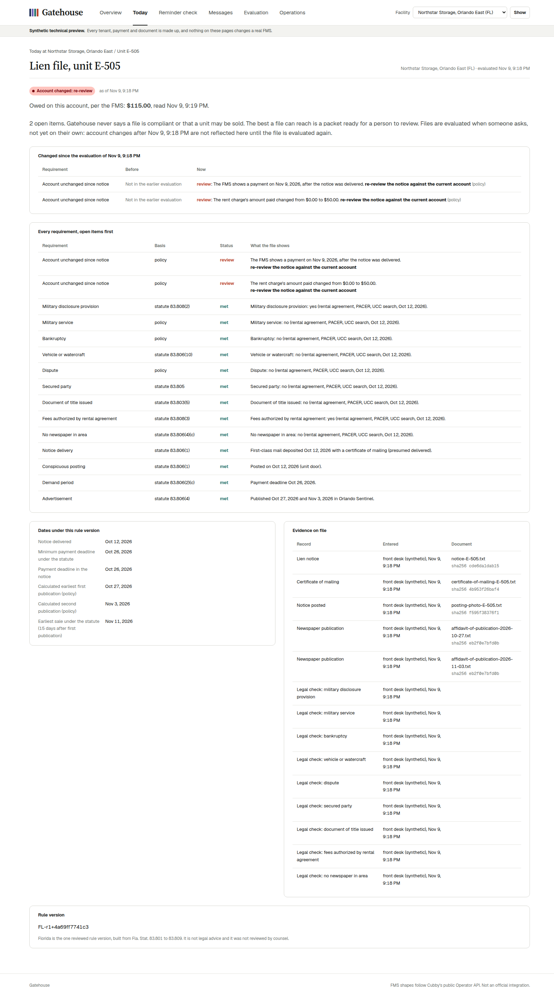
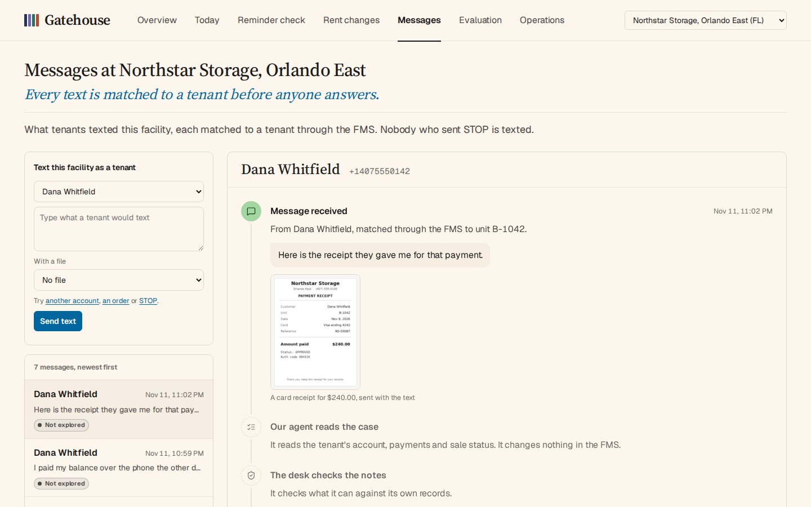
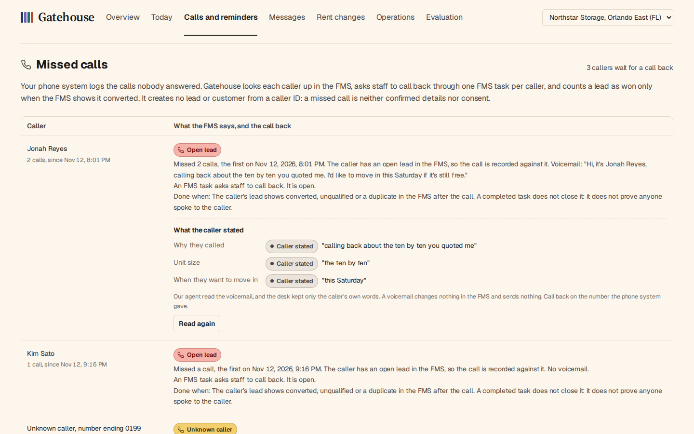
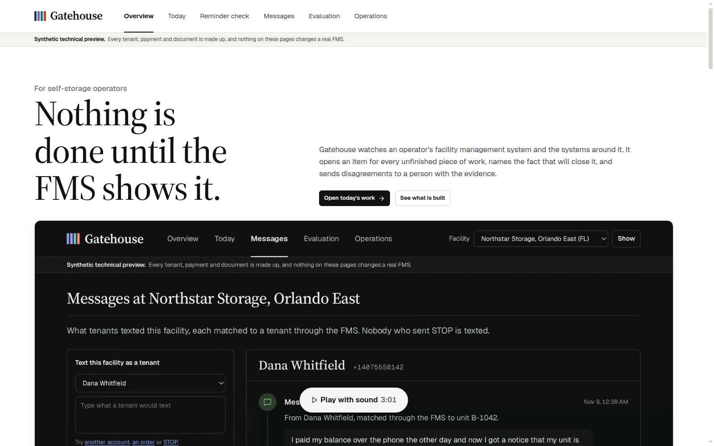

# Staddle

A self-storage FMS where Tilden, the agent inside it, works the front desk and code checks every change against the books.

https://github.com/user-attachments/assets/67a0989c-5b1c-4498-85c2-c66cc36d178d

The walkthrough shows the earlier screens, from before Staddle kept its own books; the live preview shows the FMS described below. The music is "Closer" from Mixkit, used under Mixkit's free music licence.

## Why it exists

Operators run a facility management system (FMS), a payment processor, a gate system and reminder tools. The costly failures sit between them: work one system reports done that another never finished. A card is charged and the FMS never shows it. A tenant pays and is still locked out, or still listed for auction.

AI front desks for self-storage now answer tenants. In the products surveyed for this project (their public screens, help pages and operator reviews, November 2026), a shipped AI front desk hands a fee question to staff as a ticket, or is not allowed to change tenant data. Approval steps and dollar limits for AI appear only in demos and stated plans. None shows the rule an AI applied beside the books entry it wrote.

Staddle is the FMS itself. It keeps the facility's books, Tilden reads what tenants write, and code checks each claim against those books, decides, and writes the change through one gate. Staff see every message with what Tilden read, the rule that decided and the entries it wrote; what needs a person waits for them on Today. Staddle is not a payment processor and does not give legal advice.

## The FMS

The preview opens on an Overview. The FMS is behind a sign-in that comes filled in with a demo login, and each visitor works on a copy of the facility of their own.

- **Home.** The facility this morning: work waiting, units rented by row, the month's billing and collections, who is past due.
- **Today.** What waits for a person: disputes to decide, messages handed to staff, what staff decided, and how many messages Tilden closed.
- **Messages.** This morning's tenant texts, read one at a time or all at once. Each conversation with the tenant's words, what Tilden read, what the books show, what was done, the books entries written and the reply. Try a tenant message sends one of your own through the same path.
- **Units** and **Tenants.** Who rents what at which rent, the account with its rentals and a ledger with a running balance.
- **Billing and payments.** Each month's billing, payments with the day the card was charged and the day the facility learned of it, declined cards, and who is past due.
- **Rules.** The fee schedule, the owner's rules in words and in the exact form code checks, what Tilden may do, and what only staff decide. Write a rule in plain words: Tilden turns it into an exact rule, code checks it against your words and replays last year under it, and nothing changes until you approve it as the owner on your copy.

Staff decide an open dispute on Today: remove a fee the tenant never signed for, which is a correction and does not use up a waiver, or keep it under review. Each decision goes through the same gate, with a note of what was checked.

## Tilden

Tilden reads a tenant's message into claims, each with the tenant's own words. Code checks each claim against the books and decides:
- explain the charge;
- reverse a charge posted twice;
- remove a fee posted in error;
- record a dispute, held when the fee is not in the tenant's signed papers;
- waive a fee under the owner's rule;
- hand it to staff, with the reason.

Code writes the reply from what the gate recorded. Tilden cannot change the books itself. Claude Haiku 5.5 does the reading.

## How it was measured

Tilden was scored on 40 tenant messages written by a separate model that had seen neither approach, labelled by the developer from a written rubric before any run, each approach run ten times:

| Approach | Right action, average of 10 runs | Range | Same answer every run | Serious errors in any run | To staff |
|---|---|---|---|---|---|
| Tilden reads, code decides | 36 of 40 | 34 to 37 | 30 | 0 | 19 |
| A fixed-rule workflow, same books | 23 of 40 | 23 | 40 | 1 | 25 |

A serious error is money moved that should not have been. A single run on Nov 15 had given Tilden 38; run five times, the code before these fixes averaged 33.6. Those runs found three faults, fixed before the ten runs above. The check missed a card payment taken twice. A message with words aimed at the system still had a fee waived. One duplicate fee claimed twice gave a confusing reply. Because these 40 messages showed the faults, they are no longer a fresh test. Both messages Tilden got wrong in most runs went to staff instead of being explained. Tilden's reading, measured alone on 51 held-back messages, was fully right on 34 to 36 over three runs, against a bar of 49 set beforehand, with no wrong amount accepted and no dispute missed. A model choosing the action did no better than code (23 of 24 against 23), so code chooses. Reading costs about 0.03 cents a message.

Owner rules were scored the same way, on 30 sentences an owner might write. A separate model wrote them without seeing the rule form or the compiler. They were labelled by hand, field by field, and frozen before the compiler existed; only the file's description changed since. Each sentence was read ten times on Nov 17:

| Sentences | Read right, average of 10 runs | Range | Same answer every run |
|---|---|---|---|
| 10 the system must refuse | 10 of 10 | 10 | 10 |
| 20 others (adopt, already works, cannot be expressed yet) | 18.1 of 20 | 17 to 19 | 18 |

No unsafe rule was offered for approval in any run, and none of the 300 readings failed to run. The bar set beforehand (no unsafe rule, all 10 refused, at least 16 of the other 20) was met in all 10 runs. Two sentences were read wrong in most runs: one about a name that is not the tenant's (labelled "cannot be expressed yet", read as already handled) and one about a tenant who already moved out (the reverse). Reading a sentence costs about 0.05 cents.

Replies about paying overdue rent in parts were scored the same way, on 40 tenant messages a separate model wrote without seeing the reader. They were labelled by hand in the gate's own terms and frozen before the reader existed. Tilden reads each reply; code checks every amount and day against the message and decides. Each message was read ten times on Nov 18:

| Approach | Right, average of 10 runs | Range | Serious errors in any run |
|---|---|---|---|
| Tilden reads, code decides | 34.6 of 40 | 33 to 35 | 0 |
| A keyword workflow, same accounts | 27 of 40 | 27 | 2 |

A serious error is a plan accepted or a promise recorded that the tenant never clearly gave, the wrong plan or day, or any step on someone else's account. The keyword workflow accepted "I'll take option 3" as the one plan offered and took "$75 today" as a promise. This measures the reading and code's decision on each message's stated account; it did not run through the books. The first ten runs gave 35.8. Review then made the rules stricter: a promise with a condition is asked again, a yes must point at exactly one plan, and a wrong plan or day counts as serious. These are the ten runs after that change. Five messages were wrong in most runs. In three, the tenant wrote an amount without a dollar sign ("the 75", "100 today"), so code could not confirm it and asked again. In one, "please write that down" was read as words aimed at the system and sent to staff. In one, a promise tied to a bonus was read as conditional and asked again. Reading a reply costs about 0.03 cents.

## The books

The `core` package keeps the facility's records:
- an event log the database refuses to edit;
- double-entry books in whole cents;
- billing: rent on the 1st, and a late fee at midnight on the 6th;
- payments that record which charges they paid, with the day they were made and the day the facility learned of them, and customer credit;
- a gate that every change to money passes through.

A generated year of one facility runs through the same code: 120 units, 121 tenants, 122 leases, 1,662 charges and 1,279 payments.

## What is built and what is simulated

- **Built:** the books, the gate, Tilden's reading, the FMS screens, the staff decisions, owner rules written in plain words, the sign-in and the tests. The earlier reconciliation desk (below) is built too.
- **Simulated:** the facility, its tenants and its money are generated. Replies are shown, never sent. Taking card payments, gate access, move-ins and lien notices come in later steps.
- **Not shown yet:** no operator has used it.

## The earlier reconciliation desk

Before Staddle kept its own books, the project watched an FMS simulator that follows Cubby's public API and checked unfinished work against it. Its screens are off the preview now; its code and tests stay until the simulator is retired.

| | |
|---|---|
|  **Today.** Every open item at a facility, worst first, with who acts and what proves it done. A task marked done is never that proof. |  **Payments.** A card payment whose answer was lost is held and looked up, never charged twice. A payment the bank sends back reopens the account. |
|  **The record.** Each item opens to four lanes: what the FMS said, what Staddle observed, what it concluded, and what a person decided. |  **Access.** A tenant who paid and is still locked out goes to the top of Today, checked against the facility's own lockout rule. |
|  **Lien files and sales.** Every Florida requirement with its basis and evidence. A paid unit still listed for auction gets one FMS task, and an outside listing needs its own proof. |  **Messages.** Every text is matched to a tenant through the FMS. Our agent reads the case; the desk writes the reply from verified records. STOP always wins. |
|  **Calls and reminders.** Every missed caller with a usable number gets one call back, asked for in the FMS. Our agent reads a voicemail, and staff see only what the caller stated, in the caller's own words. The same page shows which past-due tenants a collections text must not reach, and why. |  **Overview.** What Staddle watches, with live counts from the desk's own records and the film. |

Every build still replays that desk's failures against the running system and fails at the first red line, such as a duplicate charge or a sale called cancelled without proof.

## Checks against a real FMS

`fms_checks` asks whether an agent tells a tenant only what the FMS shows right now, judged against a real FMS test account (it works with Stora's public API), not the simulator. Two checks: a locked unit after the tenant says they paid, and how much notice a rent increase gave. They run with `python -m fms_checks access` and `python -m fms_checks notice`. How it judges and how to plug in an agent: [docs/agent-checks.md](docs/agent-checks.md).

## Run it

```bash
cp .env.example .env          # set DESK_OPERATOR_TOKEN to a long random string
docker compose up --build     # Staddle on :8000, the FMS simulator on its loopback
```

With `DESK_PUBLIC_VIEW=1` and `DESK_DEMO_SEED=1` it serves the Overview and the FMS described above. The tests and the evaluation run in Docker, from the `test` target of the Dockerfile:

```bash
docker build --target test -t staddle:test . && docker run --rm staddle:test
```

## More

- The live preview: [staddle.onrender.com](https://staddle.onrender.com), on synthetic data.
- The [full write-up](docs/details.md) of the earlier desk: where it fits next to the vendors, each part in depth, the API, the Florida lien rules and the limits.

The FMS simulator is not an official Cubby integration, and `fms_checks` is not an official Stora integration. Lien-law reference data is from the [Stitch Storage dataset](https://stitchstorage.com/self-storage-lien-laws/data), CC BY 4.0. Staddle does not give legal advice, process real payments or authorize property sales.
