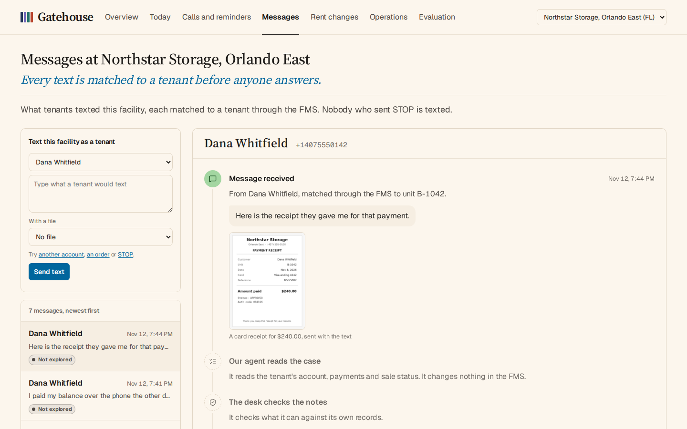
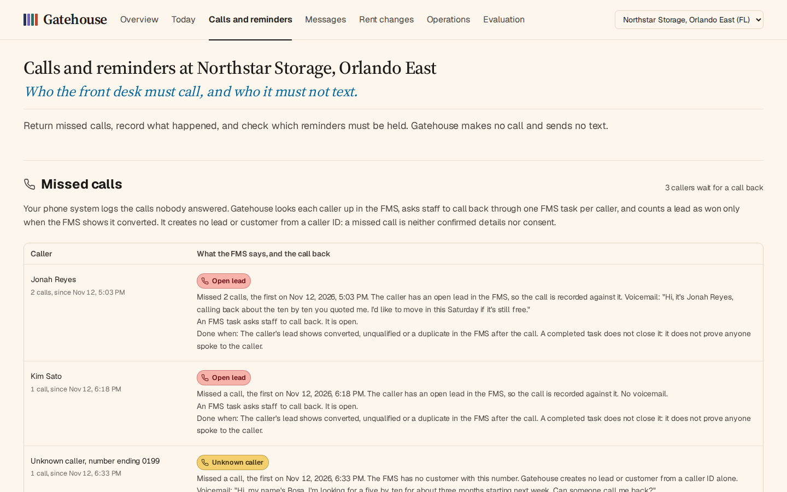

# Gatehouse

Unfinished work in self-storage, checked against the FMS.

https://github.com/user-attachments/assets/67a0989c-5b1c-4498-85c2-c66cc36d178d

The walkthrough, two and a half minutes with sound, recorded on the live preview. The music is "Closer" from Mixkit, used under Mixkit's free music licence.

## Why it exists

Operators already run a facility management system (FMS), a payment processor, a gate system and reminder tools. The costly failures sit between them: work one system reports done that another never finished. A card is charged and the FMS never shows it. A tenant pays and is still locked out, or still listed for auction. A sale is cancelled in the FMS and still listed on an outside site.

Gatehouse finds that work, keeps the evidence, and closes an item only when the system of record shows the fact that proves it done. When the systems disagree, a person decides from the evidence. It is not an FMS, a reminder bot, a payment processor or legal advice.

## What it does

| | |
|---|---|
|  **Today.** Every open item at a facility, worst first, with who acts and what proves it done. A task marked done is never that proof. |  **Payments.** A card payment whose answer was lost is held and looked up, never charged twice. A payment the bank sends back reopens the account. |
|  **The record.** Each item opens to four lanes: what the FMS said, what Gatehouse observed, what it concluded, and what a person decided. |  **Access.** A tenant who paid and is still locked out goes to the top of Today, checked against the facility's own lockout rule. |
|  **Lien files and sales.** Every Florida requirement with its basis and evidence. A paid unit still listed for auction gets one FMS task, and an outside listing needs its own proof. |  **Messages.** Every text is matched to a tenant through the FMS. Our agent reads the case; the desk writes the reply from verified records. STOP always wins. |
|  **Calls and reminders.** Every missed caller with a usable number gets one call back, asked for in the FMS. The same page shows which past-due tenants a collections text must not reach, and why. |  **Overview.** What Gatehouse watches, with live counts from the desk's own records and the film. |

**Rent changes.** Whether each increase the FMS holds can go ahead, was applied on its date, and was billed at the new rent in a full period. A notice is never shown as proven.

**Evaluation.** Every build replays the failures against the running system: lost answers, late money, returned payments, wrong numbers, tasks marked done without the work. It counts each red line, such as a duplicate charge or a sale called cancelled without proof, and fails at one. Deliberately wrong builds are run too, to show each check catches what it is for.

## Our agent

Our agent does the reading: it looks up the tenant's records, writes the case notes and asks for actions. Gatehouse decides, acts and reads the result back from the FMS. The agent cannot change the FMS, charge a card or send a text itself; every sentence a tenant receives is written by the desk from a verified record. On the preview, visitors run it live, inside a daily budget and a per-visitor allowance.

## What is built and what is simulated

- **Built:** the desk, its worker, every check above, the live agent runs and the evaluation.
- **Simulated:** the FMS, with its gate codes and unit locks, the phone system's missed-call log and the outside auction site. The FMS simulator follows Cubby's public API documentation, including its awkward parts: a decline still answers 200, a pending payment must never be retried, and a text has no idempotency key.
- **Not shown yet:** no operator has used it. All tenants, facilities and payments are synthetic.

## Run it

```bash
cp .env.example .env          # set DESK_OPERATOR_TOKEN to a long random string
docker compose up --build     # Gatehouse on :8000, the FMS simulator on its loopback
```

The tests and the evaluation run in Docker, from the `test` target of the Dockerfile:

```bash
docker build --target test -t gatehouse:test . && docker run --rm gatehouse:test
```

## More

- The live preview: [gatehouse-peug.onrender.com](https://gatehouse-peug.onrender.com), on synthetic data.
- The [full write-up](docs/details.md): where it fits next to the vendors, each part in depth, the API, the Florida lien rules and the limits.

The FMS simulator is not an official Cubby integration. Lien-law reference data is from the [Stitch Storage dataset](https://stitchstorage.com/self-storage-lien-laws/data), CC BY 4.0. Gatehouse does not give legal advice, process real payments or authorize property sales.
